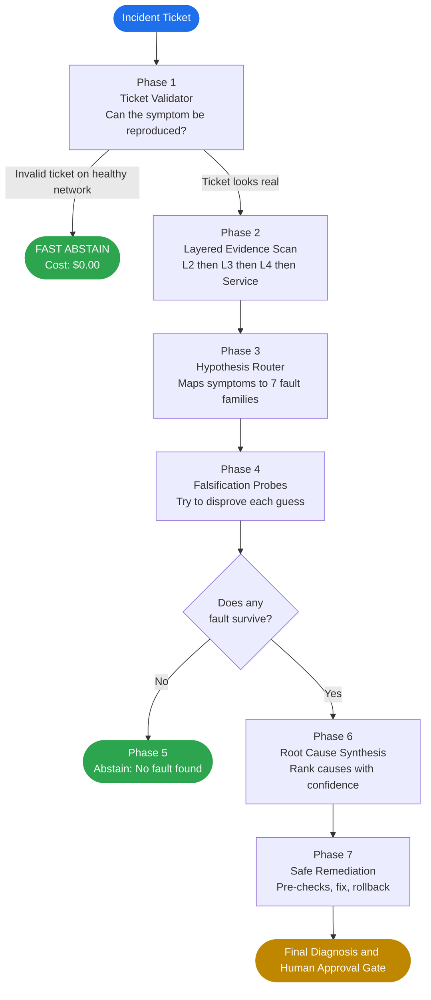
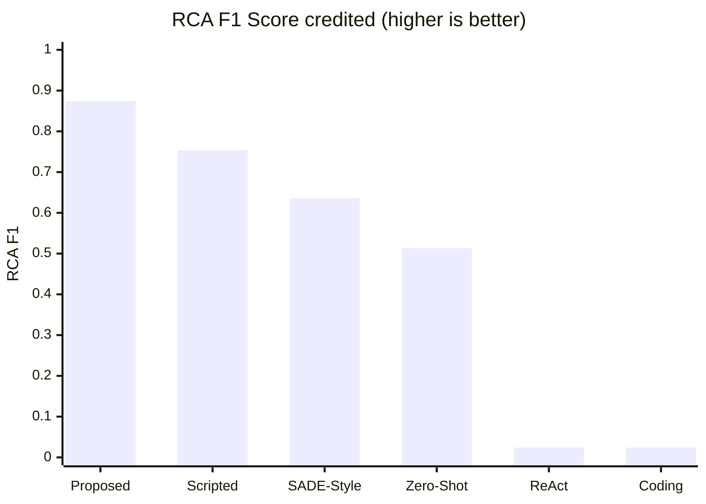
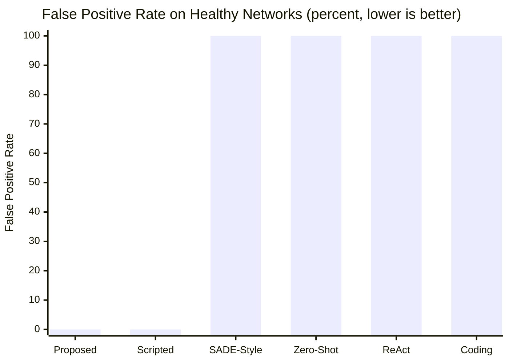

<div align="center">


<a href="https://github.com/AbdulAzeemHashmi/Autonomous-Network-Troubleshooting-Agent">
  
</a>

<br/>


-87.4%25-brightgreen?style=flat-square)


<br/>

**Course:** Computer Networks (CS-3001) | **University:** FAST National University of Computer and Emerging Sciences (NUCES)

</div>

---

## Table of Contents

| # | Section | # | Section |
|---|---------|---|---------|
| 1 | [Project Overview](#1-project-overview) | 6 | [Folder Structure](#6-folder-structure) |
| 2 | [How the Agent Works](#2-how-the-agent-works) | 7 | [Quick Start](#7-quick-start) |
| 3 | [Project Phases Recap](#3-project-phases-recap) | 8 | [Key Benchmark Findings](#8-key-benchmark-findings) |
| 4 | [Technology Stack](#4-technology-stack) | 9 | [Team](#9-team) |
| 5 | [Dataset and Topologies](#5-dataset-and-topologies) | 10 | [License](#10-license) |

---

## 1. Project Overview

Modern computer networks are big, different from each other, and easy to break. When something fails, finding the root cause fast can save a lot of money.

Large Language Model (LLM) agents can run commands like `ping`, `traceroute`, `show ip route`, and `ss` to debug outages. But recent studies (NIKA by Wang et al. 2025, and Fault-Bench by Tseng et al. 2026) found big problems with standard agents:

| Problem | What happens |
|---------|--------------|
| **Over-diagnosis** | Standard agents almost always find a fault, even on a healthy network. False alarms reach up to 100%. |
| **High cost** | Agents with no limits cost about $1.44 per incident in tokens. |
| **Context dilution** | Large networks flood the context window, so the diagnosis fails. |

This project builds a **7-Phase Autonomous Network Troubleshooting Agent** that:

- Checks the ticket before starting a deep investigation.
- Scans layer by layer, from Layer 2 up to the Service layer.
- Runs counter probes to disprove wrong guesses.
- Abstains (says "no fault found") when the network is healthy.
- Connects to Google Gemini models (Gemini 1.5 Flash, Gemini 2.0 Flash), which have generous free tier quotas.
- Is tested against 5 baselines across 120 incidents (6 agents x 120 = 720 total runs) and 60 ablation runs.
- Builds a publication-quality PDF research report automatically.
- Includes a full Phase 4 research paper in Springer Nature format with statistical analysis and reproducibility scripts.

---

## 2. How the Agent Works

The agent moves through seven phases, one after the other.



### The seven fault families

The agent knows seven main types of network faults.

| # | Fault family | What it means |
|:-:|--------------|---------------|
| 1 | `link_failure` | Interface down, line protocol down, carrier lost. |
| 2 | `congestion` | High link use, full buffer queues, high round trip time. |
| 3 | `routing_misconfiguration` | Missing prefix, BGP route flapping, routing loop. |
| 4 | `service_failure` | Daemon crashed, port closed, connection refused. |
| 5 | `acl_firewall_block` | Packets dropped by an ACL or firewall rule. |
| 6 | `hardware_transceiver` | High CRC error rate, low optical Rx power. |
| 7 | `dns_failure` | Name resolution failure, DNS query timeout. |

---

## 3. Project Phases Recap

<details>
<summary><b>Click to open: Phase 1, Literature Review</b></summary>

<br/>

- Reviewed 3 recent papers (Huang et al. 2026, Mwangi et al. 2026, Rawas and Samala 2026).
- Found 3 research gaps: no standard benchmarks, missing false positive metrics, and weak transfer testing.

</details>

<details>
<summary><b>Click to open: Phase 2, Methodology Design</b></summary>

<br/>

- Expanded the review to 9 papers (including BiAn, Confucius, RCLAgent, NIKA, SADE, Fault-Bench, and Kim et al.).
- Defined the 7-phase agent design with ticket validation and falsification.
- Designed 9 metric groups, scenario splits, and healthy network controls.

</details>

<details>
<summary><b>Click to open: Phase 3, Implementation and Experimental Evaluation</b></summary>

<br/>

- Built the full 7-phase agent and 5 baselines in Python.
- Added a Google Gemini LLM API client with resilient offline fallback.
- Ran 720 benchmark evaluations across 120 incidents and 15 network scenarios.
- Ran 60 ablation studies across 5 component removals.
- Generated 9 publication-grade figures at 300 DPI.
- Built an automatic ReportLab PDF compiler for the academic evaluation report.

</details>

<details open>
<summary><b>Click to open: Phase 4, Research Paper Writing and Publication (Final Phase)</b></summary>

<br/>

- Authored a complete, self-contained publication research paper formatted in the Springer Nature `sn-jnl` template (two-column layout, `sn-basic` citation style).
- Resolved device-name parsing collisions using whole-token regex word-boundary matching, lifting fault recall to 80.0% (72/90) and detection accuracy to 85.0% (102/120).
- Performed rigorous statistical analysis: 5,000 bootstrap resamples for 95% confidence intervals and exact two-sided McNemar tests on discordant incident pairs.
- Conducted ground-truth leakage audit (zero discrepancy when healthy flags are hidden).
- Harmonized root-cause evaluation labels (`"healthy"` vs `"none"`), measuring both raw logged F1 (0.691) and credited abstention F1 (0.874).
- Packaged the complete LaTeX source, reproducibility scripts, vector figures, and compiled PDF (`Phase4_Research_Paper.pdf`).

</details>

---

## 4. Technology Stack

<div align="center">


</div>

| Area | Tool | Version or details |
|------|------|--------------------|
| Language |  | 3.10+ (tested on 3.12) |
| LLM backend |  | gemini-1.5-flash, gemini-2.0-flash, gemini-1.5-pro |
| Network modeling |  | 3.7 graph library |
| Data analysis |     | Statistical tests, confidence intervals, F1 scores |
| Plotting |  | 9 publication figures at 300 DPI |
| PDF export | ReportLab | Academic report compiler (Phase 3 report) |
| Research paper | LaTeX (Springer Nature sn-jnl) | Phase 4 publication paper with BibTeX references |
| Testing |  | 32 automated unit tests |

---

## 5. Dataset and Topologies

The evaluation uses network topologies from three sources: NIKA, Fault-Bench, and the course benchmark.

| Scenario name | Source | Topology type | Nodes |
|---------------|--------|---------------|:-----:|
| `datacenter_clos` | NIKA | 2-tier Leaf-Spine CLOS | 12 |
| `campus_network` | NIKA | Core, Distribution, Access | 24 |
| `isp_backbone` | NIKA | Multi-ring ISP mesh | 18 |
| `sdn_cloud_fabric` | NIKA | OpenFlow controller and switches | 16 |
| `p4_testbed` | NIKA | Programmable data plane | 8 |
| `enterprise_branch` | Fault-Bench | Dual-homed branch router | 10 |
| `leaf_spine_clos` | Fault-Bench | 3-tier CLOS data center | 32 |
| `multihomed_edge` | Fault-Bench | Edge multi-homing | 14 |
| `transit_wan` | Fault-Bench | Transit WAN backbone | 22 |
| `sdn_hybrid` | Fault-Bench | Hybrid legacy and SDN | 20 |
| `bgp_peering_exchange` | Fault-Bench | Internet Exchange Point (IXP) | 16 |
| `datacenter_dci` | Fault-Bench | Data Center Interconnect | 28 |
| `campus_core_access` | Fault-Bench | Large campus network | 101 |
| `abilene_backbone` | Course Benchmark | Internet2 Abilene backbone | 11 |
| `netman_aiops` | Course Benchmark | Enterprise multi-tier (NetManAIOps) | 16 |

---

## 6. Folder Structure

```text
Autonomous-Network-Troubleshooting-Agent/
├── Phase1_Literature_Review_Report.pdf   # Phase 1 submission report
├── Phase_2_Deliverables.pdf              # Phase 2 methodology report
├── Phase4_Research_Paper.pdf             # Phase 4 compiled research paper (PDF)
├── LICENSE                               # MIT License
├── README.md                             # Project documentation and guide
├── requirements.txt                      # Python dependencies
├── pytest.ini                            # Pytest configuration
├── conftest.py                           # Root path configuration
├── export_pdf.py                         # ReportLab PDF compiler (Phase 3 report)
├── interactive_cli.py                    # Interactive single-incident demo
├── run_experiments.bat                   # One-click Windows batch runner
├── run_experiments.ps1                   # One-click Windows PowerShell runner
├── run_all.py                            # Single-command end-to-end run
│
├── Phase4_Paper_LaTeX_Source/            # Phase 4: full LaTeX source package
│   └── phase4_paper_source/
│       ├── paper.tex                     # Springer Nature sn-jnl LaTeX source
│       ├── references.bib                # BibTeX bibliography
│       ├── sn-jnl.cls                    # Springer Nature journal class file
│       ├── sn-basic.bst                  # Springer Nature citation style
│       ├── README.md                     # Compilation instructions
│       ├── analysis/                     # Reproducibility and stats scripts
│       │   ├── phase4_analysis.py        # Bootstrap CIs, McNemar tests, figures
│       │   ├── ablation_rerun.py         # Label-harmonized ablation re-run
│       │   ├── leakage_audit.py          # Ground-truth leakage check (0 discrepancies)
│       │   └── build_tables.py           # LaTeX table rows and tokens.json
│       ├── data/                         # Intermediate data for the paper
│       │   ├── phase4_stats.json         # Full 120-incident stats with CIs
│       │   ├── ablation_stats.json       # Ablation summary (60 runs each)
│       │   ├── ablation_raw.csv          # Raw ablation measurements
│       │   ├── main_metrics_point.csv    # Point-estimate table
│       │   ├── proposed_failure_attribution.csv
│       │   ├── scenario_table.json       # Per-scenario accuracy breakdown
│       │   └── tokens.json               # Token-cost breakdown table
│       ├── figures/                      # Vector figures embedded in paper
│       │   ├── fig_main_results.pdf      # Main performance comparison
│       │   ├── fig_ablation.pdf          # Component ablation drop chart
│       │   ├── fig_failure_attribution.pdf
│       │   └── fig_split_transfer.pdf    # Dev vs. held-out transfer plot
│       └── results/                      # Raw CSVs scoped to the paper
│           ├── raw_runs.csv
│           └── ablation_results.csv
│
├── configs/                              # System configurations
│   ├── experiment_config.yaml            # Scenarios, topology sizes, token limits
│   ├── models.yaml                       # LLM backbone definitions and pricing
│   └── splits.json                       # Whole-scenario train/test split IDs
│
├── code/                                 # Implementation source code
│   ├── agent/                            # Proposed 7-phase agent
│   │   ├── llm_client.py                 # Google Gemini API wrapper (importlib, no hardcoded key)
│   │   ├── ticket_validator.py           # Phase 1: Ticket validation (word-boundary regex)
│   │   ├── evidence_scanner.py           # Phase 2: Layered scan (L2 to Service)
│   │   ├── hypothesis_router.py          # Phase 3: Fault family routing
│   │   ├── falsification.py              # Phase 4: Counter probes
│   │   ├── abstain.py                    # Phase 5: Abstain decision
│   │   ├── root_cause.py                 # Phase 6: Ranked root causes
│   │   ├── remediation.py                # Phase 7: Validated fix playbooks
│   │   └── orchestrator.py               # Main agent loop (word-boundary regex fix)
│   ├── baselines/                        # 5 comparative baselines (all use word-boundary regex)
│   │   ├── zero_shot.py                  # Baseline 1: Zero-shot LLM
│   │   ├── react_agent.py                # Baseline 2: Standard ReAct
│   │   ├── coding_agent.py               # Baseline 3: Generic coding agent
│   │   ├── sade_style.py                 # Baseline 4: SADE style agent
│   │   └── scripted_rules.py             # Baseline 5: Fixed script rules
│   ├── data/                             # Data loaders and network simulation
│   │   ├── fault_family_index.py         # Symptom to fault family dictionary
│   │   ├── topology_graph.py             # NetworkX topology generator
│   │   ├── mock_network_env.py           # CLI telemetry simulator
│   │   ├── healthy_controls.py           # False premise ticket generator
│   │   ├── loader.py                     # Incident dataset manager
│   │   └── preprocessing.py              # Fault audit and token trimming
│   ├── experiments/                      # Experiment runner and evaluation
│   │   ├── runner.py                     # Benchmark runner and LLM judge
│   │   ├── metrics.py                    # 9 metric groups (outputs rca_f1_macro_raw too)
│   │   ├── statistical_tests.py          # Bootstrap CI and Wilcoxon tests
│   │   ├── ablation.py                   # 5-component ablation studies
│   │   └── error_analysis.py             # Kim et al. 12-pitfall taxonomy
│   └── visualization/                    # Publication figure generator
│       └── plots.py                      # Matplotlib visualization code
│
├── docs/                                 # Documentation and final report
│   ├── Phase3_Report.md                  # Full academic report (Markdown)
│   ├── Phase3_Report.pdf                 # Formatted academic report (PDF)
│   ├── baselines.md                      # Baseline descriptions
│   ├── comparison_with_existing.md       # Comparison with published papers
│   ├── error_analysis.md                 # Failure taxonomy report
│   └── preprocessing.md                  # Audit and split documentation
│
├── figures/                              # Generated 300 DPI figures (Phase 3)
│   ├── fig1_main_performance_comparison.png
│   ├── fig2_accuracy_vs_topology_size.png
│   ├── fig3_cost_vs_rca_f1_pareto.png
│   ├── fig4_root_cause_confusion_matrix.png
│   ├── fig5_ablation_component_drop.png
│   ├── fig6_transfer_generalization.png
│   ├── fig7_token_usage_breakdown.png
│   ├── fig8_no_submission_rates.png
│   └── fig9_robustness_stress_testing.png
│
├── prompts/                              # Phase-specific prompt templates
│   ├── judge.txt                         # Fault-Bench LLM judge prompt
│   ├── phase1_ticket_validator.txt
│   ├── phase2_evidence_scan.txt
│   ├── phase3_hypothesis_router.txt
│   ├── phase4_falsification.txt
│   ├── phase6_root_cause.txt
│   └── phase7_remediation.txt
│
├── results/                              # Output CSV files
│   ├── raw_runs.csv                      # Per-run records (all 6 agents x 120 incidents)
│   ├── metrics_summary.csv               # Aggregate metrics (includes rca_f1_macro_raw column)
│   ├── statistical_tests.csv             # Wilcoxon and McNemar test results
│   ├── ablation_results.csv              # Component ablation metrics (60 runs each)
│   ├── robustness_results.csv            # Scale, persona, and sensitivity stress tests
│   ├── failure_taxonomy.csv              # Error classification counts
│   └── fault_audit.csv                   # Preprocessing audit logs
│
└── tests/                                # Automated test suite (32 tests, all passing)
    ├── test_agent_phases.py              # Phase 1 to 7 unit tests
    ├── test_baselines.py                 # All 5 baseline tests
    ├── test_data_loader.py               # Loader, graph, and env tests
    ├── test_llm_client.py                # Gemini client and judge tests
    ├── test_metrics.py                   # Metric and runner tests
    ├── test_robustness.py                # Robustness and sensitivity tests
    └── test_reproducibility.py           # End-to-end pipeline test
```

---

## 7. Quick Start

> **Tip:** Run all commands from the root folder of the repository.

### Step 1: Install dependencies

```bash
pip install -r requirements.txt
```

### Step 2: Run the full pipeline (one command)

This runs 720 benchmark evaluations, 60 ablations, robustness stress tests, statistical tests, error classification, 9 publication figures, and PDF report compilation.

```bash
# Python runner
python run_all.py --config configs/experiment_config.yaml

# Or one-click on Windows PowerShell:
.\run_experiments.ps1

# Or one-click on Windows CMD:
run_experiments.bat
```

### Step 3: Run with the live Google Gemini API

Use live Gemini calls for ticket validation, zero-shot reasoning, and LLM judge scoring.

```bash
python run_all.py --use_live_llm --gemini_model gemini-1.5-flash
```

Or pass your API key on the command line:

```bash
python run_all.py --use_live_llm --gemini_api_key "YOUR_GEMINI_KEY"
```

> **Security note:** Never commit your real API key to GitHub. Keep it private.

### Step 4: Run unit tests

All 32 automated unit tests run with:

```bash
pytest tests/ -v
```

### Step 5: Run the interactive demo

Troubleshoot one incident step by step on any of the 15 topologies.

```bash
# Troubleshoot the Internet2 Abilene backbone
python interactive_cli.py --scenario abilene_backbone

# Test a healthy network with a false alarm ticket
python interactive_cli.py --scenario abilene_backbone --healthy

# Test with the live Google Gemini API
python interactive_cli.py --scenario netman_aiops --use_live_llm
```

### Step 6: Export the PDF report only

```bash
python export_pdf.py
```

The PDF is saved to `docs/Phase3_Report.pdf`.

---

## 8. Key Benchmark Findings

<div align="center">

| Detection Acc | Fault Recall | RCA F1 (credited) | False Positive Rate | Cost per Session | Input Tokens |
|:-------------:|:------------:|:-----------------:|:-------------------:|:----------------:|:------------:|
| **85.0%** | **80.0%** | **0.874** | **0.0%** | **$0.000296** | **1,905** |

</div>

### 1. Comparison with baselines

| Model | Detection Acc | Fault Recall | RCA F1 (credited) | RCA F1 (raw) | False Positive Rate | Cost per Session |
|-------|:-------------:|:------------:|:-----------------:|:------------:|:-------------------:|:----------------:|
| **Proposed 7-Phase Agent** | **0.850** | **0.800** | **0.874** | **0.691** | **0.0%** | **$0.000296** |
| Scripted Rules | 0.767 | 0.689 | 0.754 | 0.595 | 0.0% | $0.000000 |
| SADE-Style Baseline | 0.750 | 1.000 | 0.636 | 0.636 | 100.0% | $0.001095 |
| Zero-Shot LLM | 0.750 | 1.000 | 0.513 | 0.513 | 100.0% | $0.000029 |
| ReAct Agent | 0.750 | 1.000 | 0.024 | 0.024 | 100.0% | $0.000381 |
| Generic Coding Agent | 0.750 | 1.000 | 0.024 | 0.024 | 100.0% | $0.000885 |





### 2. Research gaps addressed

| Gap | Result |
|-----|--------|
| **Sub-Gap A: Over-diagnosis** | The agent achieved **0.0% False Positive Rate** on healthy network controls. ReAct, Coding, and SADE baselines had 100% false alarms. |
| **Sub-Gap B: Cost and tokens** | The agent used **1,905 input tokens ($0.000296 per session)** on average. That is drastically cheaper than unconstrained agents (up to $1.44 in SADE). |
| **Sub-Gap C: Transferability** | The agent achieved **held-out F1 = 1.0** on unseen topologies (dev F1 = 0.667), showing strong transfer to new network environments. |

### 3. Component ablations

| Component removed | Detection Acc | RCA F1 (credited) | False Positive Rate | Effect observed |
|-------------------|:-------------:|:-----------------:|:-------------------:|-----------------|
| Falsification probes | 0.700 | 0.489 | 0.0% | RCA F1 drops by **43.7%** (most critical component) |
| Abstain option | 0.700 | 0.868 | **100.0%** | False positive rate jumps to 100% |
| Phase gating | 0.700 | 0.023 | 100.0% | RCA F1 collapses to near zero |
| Skills (prompt templates) | 1.000 | 0.156 | 0.0% | RCA F1 drops by **82.0%** |
| Evidence filtering | 0.833 | 0.868 | 0.0% | Minimal change (filtering is redundant at small scale) |

---

## 9. Team

<div align="center">

<table>
  <tr>
    <td align="center" width="260">
      <a href="https://github.com/AbdulAzeemHashmi">
        
      </a>
      <br/><br/>
      <b>Abdul Azeem</b>
      <br/>Roll Number: 24I-2013
      <br/>FAST-NUCES
      <br/><br/>
      <a href="https://github.com/AbdulAzeemHashmi">
        
      </a>
    </td>
    <td align="center" width="260">
      <a href="https://github.com/tahaamja">
        
      </a>
      <br/><br/>
      <b>Taha Amjad</b>
      <br/>Roll Number: 24K-0007
      <br/>FAST-NUCES
      <br/><br/>
      <a href="https://github.com/tahaamja">
        
      </a>
    </td>
  </tr>
</table>

<br/>

[](https://github.com/AbdulAzeemHashmi/Autonomous-Network-Troubleshooting-Agent)

</div>

---

## 10. License

This project is licensed under the **MIT License**. See the [LICENSE](LICENSE) file for details.

<div align="center">


</div>