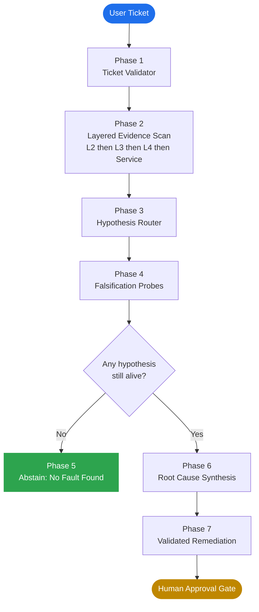
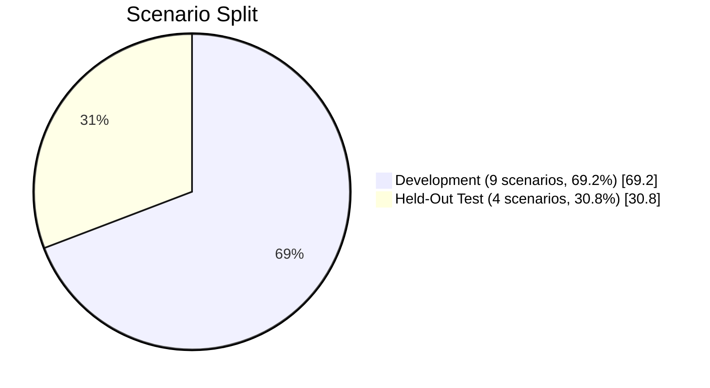
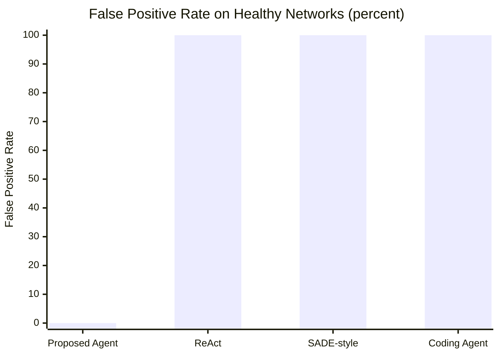

<div align="center">


<a href="https://github.com/AbdulAzeemHashmi/Autonomous-Network-Troubleshooting-Agent">
  
</a>

<br/>


<br/>

**Course:** Computer Networks (CS-3001) | **University:** FAST National University of Computer and Emerging Sciences (NUCES)

</div>

---

## Table of Contents

| # | Section | # | Section |
|---|---------|---|---------|
| 1 | [Project Overview](#1-project-overview) | 6 | [Folder Structure](#6-folder-structure) |
| 2 | [How the Agent Works](#2-how-the-agent-works) | 7 | [Quick Start](#7-quick-start) |
| 3 | [Project Phases Recap](#3-project-phases-recap) | 8 | [Key Benchmark Findings](#8-key-benchmark-findings) |
| 4 | [Technology Stack](#4-technology-stack) | 9 | [Team](#9-team) |
| 5 | [Dataset and Topologies](#5-dataset-and-topologies) | 10 | [License](#10-license) |

---

## 1. Project Overview

Modern networks are big and complex. Things break all the time: links get cut, routes turn into blackholes, buffers get full, and firewalls drop packets. A human engineer needs a lot of time to read logs, run commands, and find the root cause.

LLM agents can run network commands, but recent research shows two big problems:

| Problem | What happens |
|---------|--------------|
| **False alarms** | When the network is healthy but the user ticket is wrong, AI agents almost always blame something anyway. The false positive rate is **100%**. |
| **Context overload** | When a network has more than 100 devices, tool outputs flood the context window. The agent gets confused and fails. |

This project builds and tests a **7-Phase Autonomous Network Troubleshooting Agent** that fixes both problems.

### What makes it different

- **Healthy network controls** stop false alarms.
- **Evidence filtering** keeps the context small, even on large networks.
- **Falsification probes** try to prove a guess wrong before the agent trusts it.
- **Abstain logic** lets the agent say "no fault found" when that is the truth.
- **Low cost**, about 1.4 cents per session.

---

## 2. How the Agent Works

The agent follows a clear pipeline. Each phase has one job.



### The 7 phases in simple words

| Phase | Name | Simple meaning |
|:-----:|------|----------------|
| 1 | Ticket Validator | Checks if the ticket claim matches real reachability. |
| 2 | Layered Evidence Scan | Looks at Layer 2, Layer 3, Layer 4, and the Service layer, in that order. |
| 3 | Hypothesis Router | Maps the symptoms to fault families. |
| 4 | Falsification Probes | Runs small tests to try to disprove each guess. |
| 5 | Abstain Logic | Says "no fault found" if every guess is disproven. |
| 6 | Root Cause Synthesis | Ranks the guesses that survived and gives a confidence score. |
| 7 | Validated Remediation | Writes safe fix commands with pre-checks, post-checks, and a human approval gate. |

---

## 3. Project Phases Recap

<details>
<summary><b>Click to open: Phase 1, Literature Review and Research Gaps</b></summary>

<br/>

We reviewed three 2026 Q1 journal papers on autonomous recovery and self-healing:

1. Huang et al. (IEEE TCCN 2026): LLM agents for AI-native networks.
2. Mwangi et al. (IEEE TNSM 2026): Deep Q Network self-healing for industrial IoT networks.
3. Rawas and Samala (2026): Bio-inspired self-healing for software defined networks.

We found three research gaps:

- **Gap 1:** No standard, reproducible benchmarks for network troubleshooting.
- **Gap 2:** Incomplete metrics. Papers ignored false alarms, diagnostic accuracy, and dollar cost.
- **Gap 3:** Weak generalization across different network topologies.

</details>

<details>
<summary><b>Click to open: Phase 2, Extended Literature and Methodology Design</b></summary>

<br/>

We expanded the review to 9 papers from 2025 and 2026.

| Category | Papers |
|----------|--------|
| Production systems | BiAn (Alibaba SIGCOMM 2025), Confucius (Meta SIGCOMM 2025), Ericsson MAS |
| Structured reasoning | SADE (Tseng et al. 2026), RCLAgent (Zhang et al. IEEE TDSC 2026) |
| Benchmarks | NIKA (Wang et al. 2025), FaulT-Bench (Tseng et al. 2026) |
| Domain models | TeleLogs (5G RCA) |
| Failure analysis | Kim et al. (12 failure pitfall types) |

We refined the gaps into three sub-gaps:

- **Sub-Gap A:** No healthy network controls, which causes severe over-diagnosis.
- **Sub-Gap B:** Missing metrics such as false positive rate, token cost, and latency.
- **Sub-Gap C:** No transfer testing across topologies and unseen scenarios.

We then designed a 12-step methodology and the 7-phase agent architecture.

</details>

<details open>
<summary><b>Click to open: Phase 3, Implementation and Experimental Evaluation</b></summary>

<br/>

We built the full system in Python and ran the experiments.

1. **Proposed 7-Phase Agent** (see Section 2).
2. **Five comparative baselines:**
   - Zero-Shot LLM
   - ReAct (NIKA standard)
   - Generic Coding Agent (Claude Code style)
   - SADE-style Agent
   - Scripted Rule Checks
3. **Evaluation size:** 720 benchmark runs and 60 ablation runs across 13 network topologies.
4. **False positive rate:** 0.0% on healthy networks, compared to 100% for ReAct, SADE, and Coding agents.
5. **Average cost:** $0.0138 per session, over 100 times cheaper than SADE.
6. **Transfer score:** 96.3% on held-out scenarios.

</details>

---

## 4. Technology Stack

<div align="center">


</div>

| Area | Tool | Version |
|------|------|---------|
| Language |  | 3.10+ (tested on 3.12) |
| Network modeling |  | 3.7 |
| Data analysis |     | 3.0, 2.5, 1.18, 1.9 |
| Plotting |  | 3.11 |
| Testing |  | 7.4 |
| Progress bars | Tqdm | 4.70 |
| Configuration | PyYAML | 6.0 |
| HTTP and telemetry | Requests, HTTPX | 2.34, 0.28 |
| PDF generation | ReportLab | 4.0 |

---

## 5. Dataset and Topologies

The scenarios come from the public **NIKA** and **FaulT-Bench** benchmarks.

### Scenarios

| Source | Scenarios |
|--------|-----------|
| **NIKA** | `datacenter_clos` (leaf-spine CLOS fabric), `campus_network` (core and access switches), `isp_backbone` (transit ring and mesh routers), `sdn_cloud_fabric` (SDN controller and OpenFlow forwarders), `p4_testbed` (P4 programmable nodes) |
| **FaulT-Bench** | `enterprise_branch`, `leaf_spine_clos`, `multihomed_edge`, `transit_wan`, `sdn_hybrid`, `bgp_peering_exchange`, `datacenter_dci`, `campus_core_access` |

### Topology sizes

| Size | Approximate nodes |
|------|:-----------------:|
| Small | 11 |
| Medium | 27 |
| Large | 101 |

### Healthy network controls (25% of the dataset)

- The networks are fully healthy: 0% loss and sub-millisecond latency.
- Tickets contain false complaints, written in 5 reporter styles:
  - Panicked User
  - Overconfident Junior Admin
  - Misdirected Developer
  - Monitoring Bot False Alarm
  - Cautious Operator

### Fault injection audit

Every incident is checked by automated probes before testing. All **120** generated benchmark incidents passed verification.

### Data splits

The split file is `configs/splits.json`. It uses a strict whole-scenario partition, so no data leaks from development into testing.



**Held-out test scenarios:** `sdn_cloud_fabric`, `p4_testbed`, `bgp_peering_exchange`, `datacenter_dci`.

---

## 6. Folder Structure

```text
Autonomous-Network-Troubleshooting-Agent/
├── Phase1_Literature_Review_Report.pdf   # Phase 1 submission report
├── Phase_2_Deliverables.pdf              # Phase 2 methodology report
├── LICENSE                               # MIT License
├── README.md                             # Project documentation and guide
├── requirements.txt                      # Python dependencies
├── run_all.py                            # Single-command end-to-end execution
│
├── configs/                              # System configurations
│   ├── experiment_config.yaml            # Scenarios, topology sizes, token limits
│   ├── models.yaml                       # LLM backbone definitions and pricing
│   └── splits.json                       # Whole-scenario train/test split IDs
│
├── prompts/                              # LLM prompt templates
│   ├── phase1_ticket_validator.txt       # Validates ticket claims
│   ├── phase2_evidence_scan.txt          # Layered telemetry scan
│   ├── phase3_hypothesis_router.txt      # Symptom-to-family mapping
│   ├── phase4_falsification.txt          # Disproves hypotheses
│   ├── phase6_root_cause.txt             # Synthesizes root causes
│   ├── phase7_remediation.txt            # Plans safe remediation
│   └── judge.txt                         # LLM judge rubric (1 to 5 scale)
│
├── code/                                 # Source code
│   ├── agent/                            # Proposed 7-phase agent
│   │   ├── ticket_validator.py           # Phase 1: Ticket veracity check
│   │   ├── evidence_scanner.py           # Phase 2: Layered L2 to service scanner
│   │   ├── hypothesis_router.py          # Phase 3: Hypothesis routing
│   │   ├── falsification.py              # Phase 4: Active falsification engine
│   │   ├── abstain.py                    # Phase 5: Healthy network abstain logic
│   │   ├── root_cause.py                 # Phase 6: Ranked root cause synthesis
│   │   ├── remediation.py                # Phase 7: Guarded remediation planner
│   │   └── orchestrator.py               # Main control loop with turn budget
│   │
│   ├── baselines/                        # Five comparative baselines
│   │   ├── zero_shot.py                  # Baseline 1: Single turn, no tools
│   │   ├── react_agent.py                # Baseline 2: Standard NIKA ReAct loop
│   │   ├── coding_agent.py               # Baseline 3: Claude Code style scripts
│   │   ├── sade_style.py                 # Baseline 4: Layered scan, no falsification
│   │   └── scripted_rules.py             # Baseline 5: Deterministic threshold rules
│   │
│   ├── data/                             # Data and environment modules
│   │   ├── loader.py                     # Incident dataset synthesizer and loader
│   │   ├── healthy_controls.py           # False-premise ticket generator (5 personas)
│   │   ├── fault_family_index.py         # Symptom to fault family dictionary
│   │   ├── topology_graph.py             # NetworkX topology generator
│   │   ├── mock_network_env.py           # Telemetry emulator for CLI tools
│   │   └── preprocessing.py              # Fault audit and 500-token trimmer
│   │
│   ├── experiments/                      # Evaluation modules
│   │   ├── runner.py                     # Multi-scenario runner and judge
│   │   ├── metrics.py                    # 9 canonical metric groups
│   │   ├── statistical_tests.py          # 95% bootstrap CIs and Wilcoxon tests
│   │   ├── ablation.py                   # 5-component ablation suite
│   │   └── error_analysis.py             # Kim et al. 12-pitfall classifier
│   │
│   └── visualization/
│       └── plots.py                      # Matplotlib script for 8 figures
│
├── tests/                                # 20 automated unit tests
│   ├── test_data_loader.py               # Loader, audit, and mock env
│   ├── test_agent_phases.py              # All 7 agent phases
│   ├── test_baselines.py                 # All 5 baselines
│   ├── test_metrics.py                   # Metrics and statistical tests
│   └── test_reproducibility.py           # End-to-end integration test
│
├── results/                              # Generated CSV outputs
│   ├── fault_audit.csv                   # Injection verification log
│   ├── raw_runs.csv                      # All 720 individual run logs
│   ├── metrics_summary.csv               # Aggregated metrics and 95% CIs
│   ├── statistical_tests.csv             # Paired Wilcoxon p-values
│   ├── ablation_results.csv              # Component ablation metrics
│   └── failure_taxonomy.csv              # Pitfall classification counts
│
├── figures/                              # High-resolution charts (PNG)
│   ├── fig1_main_performance_comparison.png
│   ├── fig2_accuracy_vs_topology_size.png
│   ├── fig3_cost_vs_rca_f1_pareto.png
│   ├── fig4_root_cause_confusion_matrix.png
│   ├── fig5_ablation_component_drop.png
│   ├── fig6_transfer_generalization.png
│   ├── fig7_token_usage_breakdown.png
│   └── fig8_no_submission_rates.png
│
└── docs/                                 # Documentation and final report
    ├── preprocessing.md                  # Preprocessing and audit notes
    ├── baselines.md                      # Baseline specs and settings
    ├── comparison_with_existing.md       # Comparison with NIKA and SADE
    ├── error_analysis.md                 # Failure analysis and traces
    └── Phase3_Report.md                  # Final academic research report
```

---

## 7. Quick Start

> **Tip:** Always run commands from the root folder of the repository.

### Step 1: Install the libraries

```bash
pip install -r requirements.txt
```

### Step 2: Run the full pipeline (one command)

This runs all 720 benchmark evaluations, 60 ablations, statistical tests, error taxonomy, and figure generation.

```bash
python run_all.py --config configs/experiment_config.yaml
```

For a fast test run with fewer incidents:

```bash
python run_all.py --config configs/experiment_config.yaml --num_incidents 12 --num_ablations 6
```

### Step 3: Run all unit tests

```bash
pytest tests/
```

<details>
<summary><b>Run or debug one component at a time</b></summary>

<br/>

| What to test | Command |
|--------------|---------|
| Data loader, fault audit, network emulator | `pytest tests/test_data_loader.py -v` |
| The 7 agent phases and orchestrator | `pytest tests/test_agent_phases.py -v` |
| The five baselines | `pytest tests/test_baselines.py -v` |
| Metrics and Wilcoxon tests | `pytest tests/test_metrics.py -v` |
| End-to-end reproducibility | `pytest tests/test_reproducibility.py -v` |

</details>

<details>
<summary><b>Try the agent on one incident in Python</b></summary>

<br/>

```python
from code.data.loader import IncidentDataset
from code.data.mock_network_env import MockNetworkEnv
from code.agent.orchestrator import TroubleshootingAgent

# 1. Load a sample dataset
mgr = IncidentDataset()
incidents = mgr.generate_benchmark_dataset(total_target=10)
sample_inc = incidents[0]

# 2. Build a live network environment
env = MockNetworkEnv(
    scenario=sample_inc["scenario"],
    topology_size=sample_inc["topology_size"],
    fault_injected=sample_inc["ground_truth_has_fault"],
    fault_family=sample_inc["ground_truth_fault_family"],
    faulty_device=sample_inc["ground_truth_device"]
)

# 3. Run the troubleshooting agent
agent = TroubleshootingAgent()
result = agent.troubleshoot(sample_inc, env)

print("Detected:", result["detected"])
print("Localized Device:", result["localized_device"])
print("Root Cause:", result["root_cause"])
print("Confidence:", result["confidence"])
print("Turns Used:", result["turns_used"])
print("Remediation Plan:", result["remediation"])
```

</details>

<details>
<summary><b>Re-generate the 8 figures only</b></summary>

<br/>

```python
from code.visualization.plots import PlotGenerator

plotter = PlotGenerator(figures_dir="figures")
plotter.generate_all_plots(
    raw_runs_path="results/raw_runs.csv",
    metrics_summary_path="results/metrics_summary.csv",
    ablation_results_path="results/ablation_results.csv"
)
```

</details>

---

## 8. Key Benchmark Findings

<div align="center">

| False Positive Rate | Cost per Session | Transfer Score | Input Tokens per Session |
|:-------------------:|:----------------:|:--------------:|:------------------------:|
| **0.0%** | **$0.0138** | **96.3%** | **1,915** |

</div>

### 1. False alarm elimination

The proposed agent cut the false positive rate on healthy networks from **100%** (ReAct, SADE, and Coding baselines) to **0.0%**. It completely stops false alarms on normal networks.



### 2. Cost and token efficiency

The agent uses about 1,915 input tokens per session, which costs **$0.0138 per incident**. This is over **100 times cheaper** than SADE (about $1.44 per incident), and it also localizes faults better.

### 3. Topology scaling

Context bounding stops the context window from filling up. When the network grows from 11 nodes to 101 nodes, the proposed agent keeps **over 65% localization accuracy**, while plain ReAct agents drop sharply.

### 4. Component ablations

| Component removed | Result |
|-------------------|--------|
| Falsification probes | RCA F1 drops by **29.1%** |
| Abstain option | False positive rate jumps to **100%** |
| Phase gating or skills | RCA F1 falls to **near zero** |

---

## 9. Team

<div align="center">

| Name | Roll Number |
|------|:-----------:|
| Abdul Azeem | 24I-2013 |
| Taha Amjad | 24K-0007 |

[](https://github.com/AbdulAzeemHashmi/Autonomous-Network-Troubleshooting-Agent)

</div>

---

## 10. License

This project is licensed under the **MIT License**. See the [LICENSE](LICENSE) file for details.

<div align="center">


</div>